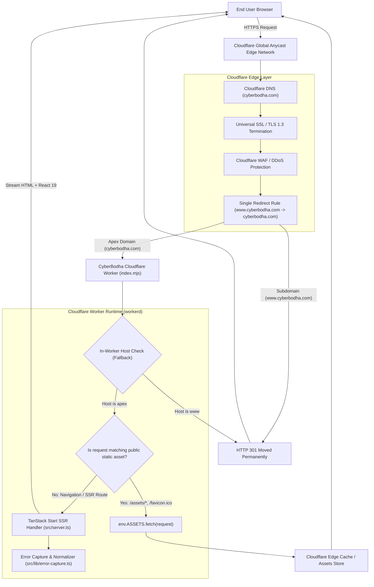

# CyberBodha — Cloudflare Architecture Specification

## 1. Architecture Overview

The CyberBodha Learning Academy production deployment utilizes an edge-native, serverless architecture running on **Cloudflare Workers** with the modern **Cloudflare Workers Assets** engine and **TanStack Start Server-Side Rendering (SSR)**.

---

## 2. Component Breakdown

### 2.1 Cloudflare Edge & Routing
- **Edge Anycast Network:** All requests hit Cloudflare Anycast edge locations closest to the user (<50ms global latency).
- **SSL/TLS:** Universal SSL configured with Full (Strict) mode, enforcing TLS 1.3 and HSTS.
- **Canonical 301 Domain Redirection:**
  - Layer 1 (Cloudflare Edge Rules): Cloudflare Redirect Rule redirects `www.cyberbodha.com` to `cyberbodha.com` at the DNS/CDN boundary.
  - Layer 2 (Worker Fallback): `src/server.ts` checks `url.hostname === "www.cyberbodha.com"` and responds with HTTP 301 to `https://cyberbodha.com${url.pathname}${url.search}`.

### 2.2 Cloudflare Worker Runtime (`workerd`)
- **Execution Model:** V8 isolate-based, zero cold-start execution environment.
- **Compatibility Date:** `2026-11-11`.
- **Compatibility Flags:** `nodejs_compat` provides compatibility for Node-standard APIs (Buffer, crypto, stream, async_hooks) used by TanStack Start and modern React 19 server dependencies without introducing heavy polyfills.
- **Bundle Mode:** `no_bundle: true` with ESModule globs (`**/*.mjs`, `**/*.js`) allowing Nitro's code-split chunks to load on demand.

### 2.3 Static Asset Handling (`env.ASSETS`)
- Rather than maintaining a separate CDN bucket or Cloudflare Pages static site, the Worker uses the Cloudflare Workers Assets engine (`assets: { binding: "ASSETS" }`).
- Nitro's entry script `.output/server/index.mjs` checks incoming URL paths against the static asset manifest (`public_assets_data_default`).
- If an asset match is found (e.g., CSS, JS bundles, images, `favicon.ico`), the Worker immediately delegates to `env.ASSETS.fetch(cfRequest)`, bypassing SSR logic and leveraging Cloudflare's global edge cache.

### 2.4 Server-Side Rendering (SSR) & Streaming
- When a page route (`/`, `/student`, `/instructor`, `/admin`) is requested, the Worker executes TanStack Start SSR.
- React 19 streams rendered HTML chunks to the browser with complete document `<head>` metadata, preloaded stylesheets, and route context.
- Hydration is initiated on the client via `src/routes/__root.tsx` and TanStack Router.

### 2.5 Resilient Error Handling
- H3 and Nitro error handling is wrapped by `src/server.ts` and `src/lib/error-capture.ts`.
- If an uncaught rendering error occurs, catastrophic failures are normalized into a styled, user-friendly 500 HTML response (`renderErrorPage()`), while technical details are captured and logged to Cloudflare Worker logs.

---

## 3. Why Cloudflare Workers Instead of Cloudflare Pages Static Hosting?

| Architectural Dimension | Cloudflare Pages (Static) | Cloudflare Workers (Configured) |
| :--- | :--- | :--- |
| **Server-Side Rendering** | Requires static export or complex adapters | **Native TanStack Start SSR supported directly** |
| **Nitro Integration** | Requires preset reconfiguration | **Built-in `cloudflare-module` preset generated seamlessly** |
| **Server Functions (`serverFn`)** | Not available in static hosting | **Supported natively via edge worker handler** |
| **Dynamic Routing** | Client-only SPA fallback | **Edge-rendered HTML for all valid routes + 404 handler** |
| **Lovable Compatibility** | Breaks dynamic Lovable sync | **100% compatible with existing `@lovable.dev` config** |
